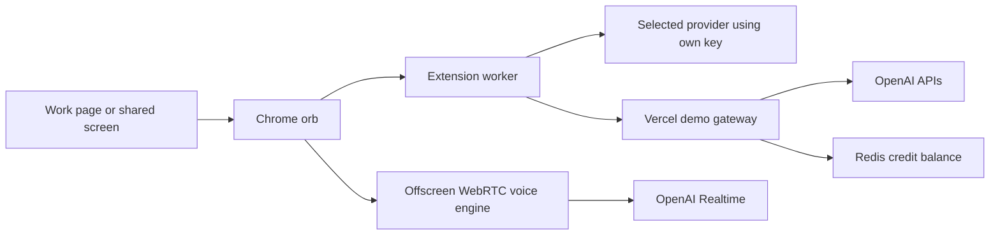

# Roody AI Companion ✦

**A speaking companion that helps you understand your work, learn, and plan—right inside a floating orb.**

Roody was built with **Claude**, with later companion, voice, demo-access, and
website updates developed with **Codex**. Claude's original commits remain in
this repository. These are development tools; the running app uses the model
APIs described below.

**Current version: Chrome hackathon demo 3.2.0.**

[Download the Chrome extension ZIP](https://github.com/F1VISABYARUN/Roody-ai/raw/refs/heads/claude/roody-k6s5sb/Roody-Companion-3.2.0-Chrome.zip)
· [Windows installation steps](START-HERE-WINDOWS.txt)
· [Vercel demo setup](server/VERCEL-DEMO.md)

## What we built

Roody is a Chrome extension for developers, founders, and people learning to
navigate unfamiliar pages. Open its orb on a work page to ask questions, talk
through a problem, or understand visible code without copying everything into
a separate chatbot.

- **Talk while you work.** OpenAI Realtime voice supports English, Telugu, and
  natural interruption. Voice controls and Settings stay inside the orb.
- **Read the page together.** Roody extracts page text and visible code from
  Monaco, CodeMirror, and Ace editors. It can discuss articles, documentation,
  code, and PDFs.
- **Analyze what you share.** Explain page can attach a tab screenshot. See my
  screen lets you choose an editor window, tab, or screen for sampled images.
  Open two files side by side to discuss their visible differences.
- **Get useful check-ins.** Optional browser following refreshes readable page
  text about every five seconds. Changed shared images are sampled about every
  twelve seconds. Speak up offers brief observations when the context changes,
  waits while either participant speaks, and uses a thirty-second cooldown.
- **Remember your next step.** Goals, tasks, blockers, persona, and language are
  saved locally and included as context in conversations.
- **Keep the controls simple.** The main view focuses on Talk and chat;
  personas, language, assistance modes, goals, and tasks are under More.

The voice engine runs in a protected offscreen extension document. Closing the
panel or changing browser pages can leave voice running. **Pause voice** stops
microphone access, browser following, and screen sharing. Screen sharing from a
particular page stops when that page navigates or closes; select the screen
again from the new page's orb.

## Personas and assistance modes

| Persona | How Roody helps |
|---|---|
| Developer | Reasons through visible code, debugging, and architecture; explains the next step. |
| Founder | Acts as a CEO/CTO-style adviser: weighs tradeoffs and turns goals into a practical plan. |
| Grandparent | Uses patient, simple explanations and helps understand unfamiliar pages one step at a time. |

| Mode | What it does |
|---|---|
| Teach me | Explains the reasoning and asks useful learning questions. |
| Do with me | Works through a problem with you. |
| Do for me | Prepares code drafts, plans, or analysis for you to review. |

These modes guide conversation. Roody does not click controls, edit files,
send messages, book appointments, or make payments.

## Install in Chrome on Windows

No npm command or terminal is needed for the Chrome extension.

1. Download **Roody-Companion-3.2.0-Chrome.zip** and choose **Extract All**.
2. Open `chrome://extensions` and turn on **Developer mode**.
3. Disable older Roody installs. Click **Load unpacked** and select the extracted
   folder containing `manifest.json`.
4. Confirm version **3.2.0**, then refresh the webpage where you want Roody.
5. Click the toolbar icon or press **Alt + R** to summon the orb.

### Connect your own key

Open orb **Settings → Use my own OpenAI key instead**, paste your key, and click
**Save key**. Clear any demo server address and save demo access to switch back
to your own key. OpenAI voice requires API billing and Realtime access; ChatGPT
subscriptions do not include API credits. Never put an owner key in a shared
ZIP or paste it into chat.

The extension also supports optional own-key Claude, Gemini, and Grok models
for text/vision requests. Model discovery chooses available models without
requiring users to type model IDs. Live voice uses OpenAI Realtime.

### Connect guest demo access

An owner can host the guest gateway on Vercel and keep the OpenAI key in server
environment variables. Guests enter the server address and their invite code
in orb Settings, then click **Save demo access**.

- Each code has **100 total app credits**.
- A text reply costs **1 credit**.
- A started voice session costs **30 credits** for up to **3 minutes**.
- Pausing a started session early does not refund its reservation.
- Sharing a code shares its balance. Redis keeps the balance across restarts
  and extension reinstalls.

App credits are separate from OpenAI dollar charges. A server background task
schedules voice shutdown, with a client timer as well; hosting or network
failure can interrupt shutdown, so this is not an unconditional billing cap.
See [Vercel setup and limits](server/VERCEL-DEMO.md) before distributing codes.

## Website and sample demos

Deployment address: **https://roodyaicompanion.vercel.app/**.

The homepage contains three clearly labeled fictional scenarios:

1. **Developer:** compare two JavaScript files and find a missing `await`.
2. **Founder:** choose a realistic priority before a hackathon presentation.
3. **Grandparent:** understand a practice appointment summary.

**Show a sample reply** displays a scripted preview with no API request or
credit use. Connecting a guest code enables actual text replies through the
OpenAI Responses API. Live voice and screen sharing use the Chrome extension.

Deploy this default branch, **`claude/roody-k6s5sb`**, with Vercel Framework
**Other**, repository root, and output directory **`public`**. The repository's
`vercel.json` configures the API. The public address returning a 404 means the
homepage deployment has not reached that address; a live provider-backed demo
also requires the environment variables in the setup guide.

## Tools and architecture

| Component | Technology implemented |
|---|---|
| Development assistance | Claude for the original build; Codex for later updates |
| Chrome orb | JavaScript, HTML/CSS, Chrome Manifest V3, content scripts, service worker |
| Voice | OpenAI Realtime API (`gpt-realtime`), WebRTC, microphone permission, transcription |
| Persistent voice host | Chrome offscreen document with extension runtime messages |
| Page and code context | DOM extraction, editor text extraction, tab screenshots, explicit screen sharing |
| Guest demo text | OpenAI Responses API (`gpt-4.1-mini`), Node.js Vercel function |
| Demo access and accounting | Invite codes, Upstash Redis REST, atomic credit reservations |
| Voice shutdown | OpenAI call hangup endpoint and Vercel `waitUntil` background task |
| Optional model providers | OpenAI, Anthropic Claude, Google Gemini, xAI Grok |
| Separate Windows prototype | Electron, selected-window screenshots, local goals/tasks, voice |
| Separate editor prototype | VS Code-compatible extension, Gemini transcription, optional ElevenLabs voice |

**MCP status:** this build has no Model Context Protocol server/client or MCP
app integrations. Personas and assistance modes are prompt-driven. Direct API
calls and browser context reading should not be described as MCP integrations.



## Privacy and current limits

- Roody's browser orb runs on work pages. Browser reading excludes banking,
  payment, email, messaging, social media, government, and pages with sensitive
  password/card fields.
- Screen sharing includes visible information in the surface you choose; those
  browser exclusions cannot filter every visible desktop app.
- Goals and tasks are stored locally. The extension does not persist screen
  images or voice recordings. Supplied text, images, and audio are transmitted
  to the selected provider to generate responses.
- The Chrome orb appears inside browser pages. It does not float over native
  Windows apps; selected screen sharing only lets it discuss their pixels.
- Desktop and editor prototypes are separate projects with separate settings.
- This is a hackathon prototype. Automated checks do not validate live billing,
  Windows microphone behavior, or Vercel background-task persistence.

Read [PRIVACY.md](PRIVACY.md) for details.

## Project layout

| Path | Purpose |
|---|---|
| `manifest.json` | Chrome extension manifest |
| `src/content.js` / `content.css` | Orb, chat, goals/tasks, page and editor reading |
| `src/background.js` | Provider routing, screenshots, protected voice controls |
| `src/companion.js` | Structured companion memory and preferences |
| `src/live-engine.html` / `voice.js` | Persistent audio engine |
| `src/orb-voice.html` / `orb-voice.js` / `orb-voice.css` | Voice controls inside the orb |
| `src/options.html` / `options.js` | Keys, invite code, server address, preferences |
| `src/study.html` / `study.js` / `pdf.js` | PDF study page |
| `public/` | Vercel homepage, samples, guest text demo, owner code page |
| `api/demo.js` / `server/demo.js` | Vercel guest gateway |
| `server/VERCEL-DEMO.md` | Deployment variables and setup instructions |
| `server/index.js` | Legacy Hostinger invite-code proxy |
| `desktop/` | Separate Electron Windows prototype |
| `editor/` | Separate VS Code-compatible editor prototype |
| `backend/` / `backend-php/` | Alternative legacy backends |
| `site/` | Earlier website and portal |
| `eval/` | Regression and behavior checks |

## Run the checks

Use Node.js 20+ for the root project:

```bash
npm ci
npm run eval
node --test eval/*.test.js
```

The desktop prototype has its own instructions and dependencies:
[desktop/README.md](desktop/README.md). The editor prototype is documented in
[editor/README.md](editor/README.md).

## Roody's journey

- **v1:** a voice companion that read along and talked out loud.
- **v2:** a coding assistant with a glass orb, editor reading, screenshots, and
  multiple model providers, built with Claude.
- **v3:** a broader companion with personas, assistance modes, goals/tasks,
  English/Telugu voice, and a separate desktop prototype.
- **v3.2:** simpler voice controls inside the orb, persistent audio, optional
  browser/screen context, Vercel guest credits, and a sample demo homepage.
